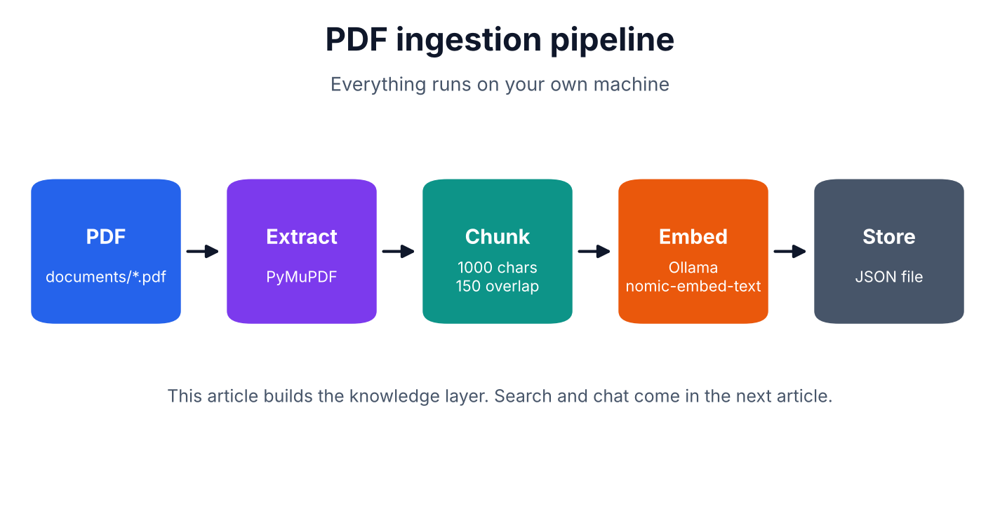

# Local PDF Ingestion

Turn a PDF into a searchable knowledge dataset using **Python**, **PyMuPDF** and a local **Ollama** embedding model. Nothing leaves your machine.



This is step 1 of a local RAG (Retrieval-Augmented Generation) series: the ingestion layer. It does **not** include similarity search or a chatbot yet.

```
PDF -> extract text -> chunk -> embed (Ollama) -> save JSON
```

## What it does

The pipeline:

1. Extracts selectable text from each PDF page with PyMuPDF.
2. Splits the text into overlapping character chunks.
3. Generates embeddings locally through Ollama.
4. Writes chunk text, metadata, and vectors to a JSON dataset.

The project is intentionally small and local-first. It does not upload documents
or embeddings to a hosted service, and it does not yet provide vector search or
a chatbot.

## Requirements

- Python 3.10 or later
- [Ollama](https://ollama.com) installed and running
- A PDF with **selectable text** (scanned PDFs need OCR first)

## Installation

Clone the repository and create a virtual environment:

```bash
git clone https://github.com/Jani-shiv/local-pdf-ingestion.git
cd local-pdf-ingestion

python -m venv venv
source venv/bin/activate
pip install -r requirements.txt
```

### Windows PowerShell

```powershell
.\venv\Scripts\Activate.ps1
python -m pip install -r requirements.txt
```

If PowerShell blocks activation scripts, allow scripts only for the current
session:

```powershell
Set-ExecutionPolicy -Scope Process Bypass
.\venv\Scripts\Activate.ps1
```

## Run the pipeline

Make sure Ollama is installed and running, then download the default embedding
model:

```bash
ollama pull nomic-embed-text
```

Generate the included sample PDF if needed:

```bash
python scripts/make_sample_pdf.py
```

Run ingestion on Linux/macOS:

```bash
PYTHONPATH=src python -m pdf_ingest documents/sample.pdf
```

Run ingestion in Windows PowerShell:

```powershell
$env:PYTHONPATH = "src"
python -m pdf_ingest documents\sample.pdf
```

The generated dataset is saved to `output/processed_data.json`. The `output/`
directory is ignored by Git because it is generated from the input PDF.

## Validate extraction without Ollama

Use `--dry-run` to extract and chunk a PDF without downloading a model or
calling the Ollama API:

```bash
PYTHONPATH=src python -m pdf_ingest documents/sample.pdf --dry-run
```

Windows PowerShell:

```powershell
$env:PYTHONPATH = "src"
python -m pdf_ingest documents\sample.pdf --dry-run
```

## Command-line options

| Flag | Default | Meaning |
|---|---|---|
| `-o, --output` | `output/processed_data.json` | Where to save the dataset |
| `--model` | `nomic-embed-text` | Ollama embedding model |
| `--ollama-url` | `http://localhost:11434` | Ollama server |
| `--chunk-size` | `1000` | Characters per chunk |
| `--overlap` | `150` | Characters shared between neighbouring chunks |
| `--batch-size` | `16` | Chunks sent to Ollama per request |
| `--dry-run` | off | Skip embeddings |

Example with custom settings:

```bash
PYTHONPATH=src python -m pdf_ingest input.pdf \
  --output output/custom.json \
  --model nomic-embed-text \
  --chunk-size 1200 \
  --overlap 200
```

## Project layout

```
src/pdf_ingest/
  extract.py   PyMuPDF text extraction (page by page)
  chunk.py     character chunking with overlap
  embed.py     batched calls to Ollama /api/embed
  store.py     JSON dataset with metadata
  cli.py       command line interface
tests/         pytest suite (Ollama is mocked)
scripts/       sample PDF + diagram generators
docs/images/   article diagrams
```

## Output format

```json
{
  "meta": {"source": "sample.pdf", "model": "nomic-embed-text", "dimensions": 768,
           "chunk_size": 1000, "overlap": 150, "chunk_count": 6, "created_at": "..."},
  "chunks": [{"id": "p1-c0", "page": 1, "chunk": 0, "text": "...", "embedding": [0.01, "..."]}]
}
```

The model name and chunk settings are stored with the vectors on purpose. Vectors from different embedding models cannot be compared with each other.

## Development

Install development dependencies:

```bash
pip install -r requirements-dev.txt
```

Run the test suite:

```bash
pytest
```

The Ollama calls are mocked in tests, so a running Ollama server is not needed
to run the test suite.

## Known limits

- Character chunking ignores paragraphs, headings and tables.
- Scanned PDFs return no text. Add an OCR step first.
- JSON is fine for learning. For large collections use a vector database.
- The default output is one JSON file, which is not suitable for very large
  document collections.
- Ollama calls are covered by mocked tests, not by a live server run in CI.

## Troubleshooting

### `source` is not recognized

`source venv/bin/activate` is for Bash. In Windows PowerShell, use:

```powershell
.\venv\Scripts\Activate.ps1
```

### `PYTHONPATH=src` is not recognized

That inline environment-variable syntax is for Bash. In Windows PowerShell,
use:

```powershell
$env:PYTHONPATH = "src"
python -m pdf_ingest documents\sample.pdf
```

### `ollama` is not recognized

Install Ollama from [ollama.com](https://ollama.com), restart the terminal,
ensure the Ollama application is running, and verify:

```powershell
ollama --version
ollama pull nomic-embed-text
```

## Next

Vector search: finding the most relevant chunks for a question.

## License

MIT
